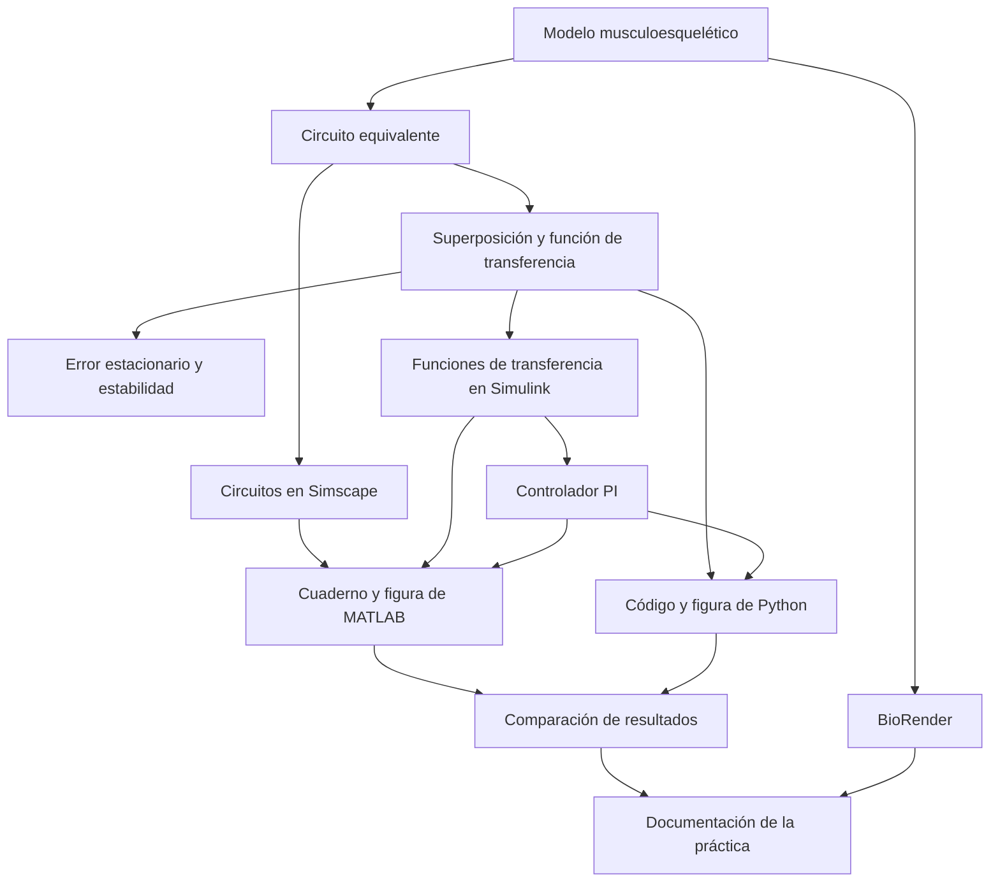

[](https://matlab.mathworks.com/open/github/v1?repo=yeseniamunguia/MSFP3)
# Práctica 3 — Modelado y control del sistema musculoesquelético

Repositorio académico de la asignatura **Modelado de Sistemas Fisiológicos**, correspondiente al programa de **Ingeniería Biomédica** del Tecnológico Nacional de México / Instituto Tecnológico de Tijuana.

En esta práctica se estudió un modelo simplificado del sistema musculoesquelético mediante una analogía fuerza–voltaje. Se obtuvo su función de transferencia por **superposición**, se analizó el error en estado estacionario y la estabilidad en lazo abierto, y se compararon las respuestas de un individuo sano (**control**) y un caso simulado de atrofia muscular (**caso**). Finalmente, se incorporó un controlador **PI** para aproximar la respuesta del caso a la del individuo sano.

**Estudiante:** Munguia Silva Yesenia Isamar  
**Número de control:** 23212217  
**Correo institucional:** l23212217@tectijuana.edu.mx  
**Docente:** Dr. Paul Antonio Valle Trujillo  
**Correo del docente:** paul.valle@tectijuana.edu.mx  
**Asignatura:** Modelado de Sistemas Fisiológicos  
**Programa:** Ingeniería Biomédica  
**Departamento:** Ingeniería Eléctrica y Electrónica  
**Institución:** Tecnológico Nacional de México / Instituto Tecnológico de Tijuana

---

<a id="contenido"></a>
## Contenido

1. [Resumen](#resumen)
2. [Competencia y objetivos](#objetivos)
3. [Modelo mecánico e interpretación fisiológica](#modelo)
4. [Analogía y circuito eléctrico equivalente](#circuito)
5. [Parámetros del control y del caso](#parametros)
6. [Análisis matemático por superposición](#matematicas)
7. [Error en estado estacionario](#error)
8. [Estabilidad en lazo abierto](#estabilidad)
9. [Implementación en Simulink y Simscape](#simulink)
10. [Cuaderno computacional de MATLAB](#matlab)
11. [Controlador PI y sintonización](#pi)
12. [Resultados de MATLAB](#resultados)
13. [Código y figura de Python](#python)
14. [Diagrama biológico en BioRender](#biorender)
15. [Discusión y conclusiones](#conclusiones)
16. [Flujo de trabajo](#flujo)
17. [Archivos y entregables](#archivos)
18. [Requisitos y reproducción](#reproduccion)
19. [Referencias](#referencias)

---

<a id="resumen"></a>
## 1. Resumen

El modelo musculoesquelético integra un elemento contráctil, un amortiguador y dos elementos elásticos. Mediante la analogía fuerza–voltaje, estos componentes se representan por fuentes de voltaje, una resistencia y dos capacitores. El análisis del circuito se realizó considerando por separado las contribuciones de las fuentes y sumando sus respuestas para obtener la función de transferencia total.

Se estudiaron dos condiciones que comparten los valores de capacitancia y el factor de fuerza activa, pero difieren en la resistencia: **100 Ω para el control** y **10 kΩ para el caso**. Se implementaron sus funciones de transferencia y circuitos equivalentes en Simulink y Simscape Electrical. El cuaderno de MATLAB ejecuta el modelo y genera una figura con la entrada, el control, el caso y el caso con PI.

La gráfica entregada muestra una respuesta rápida del control y una respuesta más lenta del caso. Al incorporar el PI, la salida del caso se aproxima a la referencia sana. El trabajo también contempla el código de Python y su figura comparativa, así como un diagrama biológico elaborado en BioRender.

La práctica se desarrolla mediante **simulación in silico**. La denominación «tratamiento» utilizada en la gráfica identifica al caso con controlador y tiene un sentido académico dentro del modelo.

**Palabras clave:** sistema musculoesquelético; analogía fuerza–voltaje; superposición; función de transferencia; estabilidad; controlador PI; MATLAB; Simulink; Simscape Electrical; Python.

---

<a id="objetivos"></a>
## 2. Competencia y objetivos

### Competencia

Modelar sistemas fisiológicos mediante analogías físicas, ecuaciones y funciones de transferencia, para interpretar su comportamiento dinámico y aplicar estrategias de control clásico.

### Objetivo general

Analizar y simular un modelo del sistema musculoesquelético en las condiciones control y caso, y evaluar el efecto de un controlador PI que utiliza la respuesta del individuo sano como referencia.

### Objetivos específicos

- Relacionar los elementos mecánicos con sus equivalentes eléctricos.
- Obtener la función de transferencia mediante superposición.
- Calcular el error en estado estacionario ante un escalón unitario.
- Determinar los polos y la estabilidad en lazo abierto.
- Implementar las funciones de transferencia y los circuitos en Simulink y Simscape Electrical.
- Comparar el control, el caso y el caso con PI en una misma figura.
- Documentar la sintonización y los parámetros del controlador.
- Complementar la comparación con el código y la figura de Python.
- Representar la correspondencia fisiológica mediante BioRender.

---

<a id="modelo"></a>
## 3. Modelo mecánico e interpretación fisiológica

El modelo de referencia representa de manera simplificada las propiedades activas, viscosas y elásticas del sistema musculoesquelético.

| Elemento | Significado en el modelo |
|---|---|
| $F_0(t)$ | Fuerza generada por el elemento contráctil activo |
| $F(t)$ | Fuerza considerada como entrada del análisis |
| $R$ | Amortiguamiento viscoso del tejido |
| $C_p$ | Compliancia del elemento elástico paralelo, asociada con estructuras musculares pasivas |
| $C_s$ | Compliancia del elemento elástico en serie, asociada de manera simplificada con el tendón y estructuras en serie |
| $x(t)$ | Desplazamiento total del modelo mecánico |
| $x_1(t)$ | Desplazamiento del elemento elástico en serie |

La relación entre la fuerza activa y la entrada es:

$$
F_0(t)=\alpha F(t),\qquad \alpha=0.25.
$$

La deformación relativa del amortiguador es $x(t)-x_1(t)$, y su velocidad relativa es la derivada de esta diferencia.

**Variable utilizada en este trabajo:** el análisis entregado y los archivos computacionales trabajan con la salida $F_s(t)$, representada eléctricamente por el voltaje sobre $C_p$. Por ello, la función de transferencia documentada es $F_s(s)/F(s)$ y las gráficas se expresan en voltios. El desplazamiento pertenece a la interpretación mecánica, pero no es la variable directamente graficada en los archivos entregados.

---

<a id="circuito"></a>
## 4. Analogía y circuito eléctrico equivalente

### Correspondencias

| Sistema mecánico | Sistema eléctrico |
|---|---|
| Fuerza | Voltaje |
| Velocidad | Corriente |
| Desplazamiento | Carga eléctrica |
| Amortiguamiento viscoso | Resistencia |
| Compliancia | Capacitancia |

Estas equivalencias permiten conservar la estructura matemática. Los valores eléctricos no deben interpretarse como conversiones directas a unidades fisiológicas sin establecer los factores de escala.

### Conexión utilizada

El circuito del análisis está formado por:

- Una fuente de entrada $F(t)$ conectada entre el nodo superior y tierra.
- Una rama con la fuente $F_0(t)$ y la resistencia $R$ en serie.
- El capacitor $C_s$ en paralelo con esa rama, entre el nodo superior y el nodo de salida.
- El capacitor $C_p$ conectado entre el nodo de salida y tierra.
- La salida $F_s(t)$ medida sobre $C_p$ respecto a tierra.

La fuente $F_0(t)$ conserva la polaridad indicada en el análisis. Su contribución a la salida aparece con signo negativo en la suma por superposición.

El circuito y sus reducciones se encuentran en el [análisis matemático](<Análisis Matemático .pdf>).

---

<a id="parametros"></a>
## 5. Parámetros del control y del caso

| Parámetro | Control: individuo sano | Caso: atrofia muscular simulada |
|---|---:|---:|
| Amplitud de la entrada utilizada | 1 V | 1 V |
| $\alpha$ | 0.25 | 0.25 |
| $C_s$ | 10 µF | 10 µF |
| $C_p$ | 100 µF | 100 µF |
| $R$ | 100 Ω | 10 kΩ |

La resistencia del caso es 100 veces mayor que la del control. Esta variación modifica la dinámica del modelo sin cambiar la ganancia estática, como se observa en el análisis matemático.

---

<a id="matematicas"></a>
## 6. Análisis matemático por superposición

El procedimiento completo se presenta en [Análisis Matemático .pdf](<Análisis Matemático .pdf>). Se consideran las contribuciones de las dos excitaciones por separado y posteriormente se utiliza la relación $F_0=\alpha F$.

### Primera contribución: fuente $F(t)$

Al sustituir la fuente $F_0(t)$ por un cortocircuito para calcular esta contribución, $R$ y $C_s$ quedan en paralelo entre la entrada y la salida. Aplicando la ley de corrientes en el nodo de salida:

$$
C_p\frac{dF_{s1}}{dt}
=C_s\frac{d(F-F_{s1})}{dt}+\frac{F-F_{s1}}{R}.
$$

Con condiciones iniciales nulas, la transformada de Laplace permite obtener:

$$
\left[R(C_p+C_s)s+1\right]F_{s1}(s)
=\left[RC_s s+1\right]F(s).
$$

Por tanto:

$$
F_{s1}(s)=\frac{RC_s s+1}{R(C_p+C_s)s+1}F(s).
$$

### Segunda contribución: fuente $F_0(t)$

Al sustituir la fuente $F(t)$ por un cortocircuito para calcular la segunda contribución, los capacitores quedan en paralelo. Su capacitancia equivalente es:

$$
C_{eq}=C_p+C_s.
$$

Con la polaridad de la fuente indicada en el circuito:

$$
F_{s2}(s)=-\frac{1}{R(C_p+C_s)s+1}F_0(s).
$$

Después se sustituye $F_0(s)=\alpha F(s)$:

$$
F_{s2}(s)=-\frac{\alpha}{R(C_p+C_s)s+1}F(s).
$$

Este cálculo separa algebraicamente las dos excitaciones y restablece al final su relación. En el circuito completo ambas fuentes actúan simultáneamente y $F_0$ sigue a $\alpha F$.

### Función de transferencia total

Sumando las contribuciones:

$$
F_s(s)=F_{s1}(s)+F_{s2}(s),
$$

$$
\boxed{G(s)=\frac{F_s(s)}{F(s)}
=\frac{RC_s s+1-\alpha}{R(C_p+C_s)s+1}.}
$$

Sustituyendo los parámetros:

| Condición | Función de transferencia |
|---|---|
| Control | $G_{control}(s)=\dfrac{0.001s+0.75}{0.011s+1}$ |
| Caso | $G_{caso}(s)=\dfrac{0.1s+0.75}{1.1s+1}$ |

Estas expresiones coinciden con los coeficientes de los bloques de función de transferencia presentes en `sistema1.slx`.

---

<a id="error"></a>
## 7. Error en estado estacionario

En el análisis matemático se calculó el error entre la entrada y la salida ante un **escalón unitario**, mediante el teorema del valor final:

$$
e_{ss}=\lim_{s\to0}s\frac{1}{s}\left[1-G(s)\right].
$$

Como:

$$
G(0)=1-\alpha=0.75,
$$

se obtiene:

$$
\boxed{e_{ss}=\alpha=0.25.}
$$

Para un escalón sostenido de 1 V, la salida final es 0.75 V y la diferencia entrada–salida es 0.25 V. Este resultado es igual para control y caso, porque $R$ no aparece en la ganancia estática.

El análisis de estado estacionario es distinto de la prueba con el pulso finito utilizada en la gráfica. También debe distinguirse del error del lazo de control, definido entre la respuesta sana y la respuesta del caso con PI.

---

<a id="estabilidad"></a>
## 8. Estabilidad en lazo abierto

El polo se obtiene igualando el denominador a cero:

$$
R(C_p+C_s)s+1=0,
$$

$$
\boxed{\lambda=-\frac{1}{R(C_p+C_s)}.}
$$

| Condición | Constante de tiempo $\tau=R(C_p+C_s)$ | Polo | Estabilidad |
|---|---:|---:|---|
| Control | 0.011 s | $-90.9091\ \mathrm{s}^{-1}$ | Estable |
| Caso | 1.1 s | $-0.9091\ \mathrm{s}^{-1}$ | Estable |

Ambos polos son reales negativos. El aumento de $R$ desplaza el polo hacia el origen y aumenta 100 veces la constante de tiempo. Esto explica la respuesta más lenta del caso, aunque ambos modelos conservan la misma ganancia estática.

---

<a id="simulink"></a>
## 9. Implementación en Simulink y Simscape

El archivo principal es [sistema1.slx](sistema1.slx). Contiene los subsistemas **Control** y **Caso**.

| Subsistema | Implementación |
|---|---|
| Control | Circuito equivalente en Simscape Electrical y función de transferencia del individuo sano |
| Caso | Circuito equivalente en Simscape Electrical, función de transferencia en lazo abierto y una rama con PI y la planta del caso |

Los circuitos utilizan fuentes de voltaje controladas, resistencia, capacitores, sensor de voltaje, referencia eléctrica y bloques de conversión entre señales de Simulink y señales físicas. La fuente $F_0(t)$ se obtiene a partir de la entrada con una ganancia de 0.25.

Los bloques Scope permiten visualizar las salidas del circuito equivalente y de la función de transferencia. El modelo entregado implementa estas dos representaciones; el desarrollo por ecuaciones se documenta en el análisis matemático.

### Entrada realmente utilizada

Aunque el cuaderno titula la sección «Respuesta al impulso unitario», el generador del modelo y la figura entregada corresponden a un **pulso rectangular**:

$$
F(t)=u(t-1)-u(t-2).
$$

| Ajuste | Valor |
|---|---:|
| Amplitud observada | 1 V |
| Periodo del generador | 10 s |
| Ancho de pulso | 10 % del periodo: 1 s |
| Retardo | 1 s |
| Intervalo mostrado | 0 a 10 s |

En esta ventana la entrada permanece activa entre 1 y 2 segundos. Su área es 1 V·s, pero su duración finita hace que su respuesta no sea idéntica a la de un impulso ideal de Dirac. Para reproducir la figura en Python debe utilizarse este mismo pulso.

---

<a id="matlab"></a>
## 10. Cuaderno computacional de MATLAB

El cuaderno [Munguia23212217.mlx](Munguia23212217.mlx) incluye los datos académicos, la ejecución del modelo y la función de graficación. Su exportación es [Munguia23212217.pdf](Munguia23212217.pdf).

La simulación se ejecuta con:

```matlab
clc; clear; close all; warning('off','all')
tend = '10';
file = 'sistema1';
open_system(file)
parameters.StopTime = tend;
parameters.Solver = 'ode15s';
parameters.MaxStep = '1e-3';
X = sim(file,parameters);
```

Las señales se representan mediante:

```matlab
plotsignals(X.t,X.F,X.Fsx,X.Fsy,X.PID)
```

| Variable | Contenido |
|---|---|
| `X.t` | Tiempo de simulación |
| `X.F` | Entrada $F(t)$ |
| `X.Fsx` | Salida del control |
| `X.Fsy` | Salida del caso sin controlador |
| `X.PID` | Salida del caso con PI; se conserva el nombre de variable del archivo |

La figura utiliza un fondo blanco, tipografía Times New Roman, leyenda superior y una ventana temporal de 0 a 10 s. El eje vertical se expresa en voltios y se muestra de −0.1 a 1.1 V.

La exportación se realiza en formato vectorial:

```matlab
exportgraphics(gcf, 'Caso_Control_matlab.pdf','contenttype','vector')
```

---

<a id="pi"></a>
## 11. Controlador PI y sintonización

El bloque denominado `PID Controller` está configurado como **PI**, en forma paralela y tiempo continuo. No se utiliza acción derivativa.

La salida del individuo sano se utiliza como referencia:

$$
e(t)=F_{s,control}(t)-F_{s,PI}(t).
$$

El controlador tiene la forma:

$$
K(s)=k_P+\frac{k_I}{s}.
$$

La transferencia desde la referencia hasta la salida del caso controlado es:

$$
T(s)=\frac{K(s)G_{caso}(s)}{1+K(s)G_{caso}(s)}.
$$

Desde la entrada original, la respuesta controlada es:

$$
F_{s,PI}(s)=T(s)G_{control}(s)F(s).
$$

### Parámetros registrados

La captura del sintonizador y el modelo guardado presentan valores ligeramente diferentes:

| Parámetro | Captura de PID Tuner | Guardado en `sistema1.slx` |
|---|---:|---:|
| $k_P$ | 0.21435 | 0.213191204829284 |
| $k_I$ | 3717.1212 | 3737.3541590977 |
| $k_D$ | No aplica | 0 |
| Tipo | PI | PI |

La captura se conserva como evidencia de sintonización. Al ejecutar el `.slx` se utilizan las ganancias guardadas en el bloque; para una comparación reproducible, Python debe utilizar las mismas ganancias que la versión de Simulink ejecutada. La figura exportada no permite determinar por sí sola cuál de las dos sintonizaciones se utilizó para generarla.

### Desempeño mostrado en PID Tuner

| Indicador | Valor de la captura |
|---|---:|
| Tiempo de subida | 0.00628 s |
| Tiempo de establecimiento | 0.00997 s |
| Sobreimpulso | 1.69 % |
| Pico | 1.02 |
| Margen de fase | 90° a 338 rad/s |
| Estabilidad del lazo cerrado | Estable |

Estos indicadores corresponden a la **prueba de seguimiento de escalón del sintonizador**, no a una medición directa de la figura completa con entrada de pulso.


---

<a id="resultados"></a>
## 12. Resultados de MATLAB

La figura [Caso_Control_matlab.pdf](Caso_Control_matlab.pdf) reúne cuatro señales:

| Señal | Representación |
|---|---|
| Entrada $F(t)$ | Línea morada continua |
| $F_s(t)$: Control | Línea durazno continua |
| $F_s(t)$: Caso | Línea verde discontinua |
| $F_s(t)$: Tratamiento | Línea morada discontinua; salida del caso con PI |

### Interpretación

Antes de 1 s, las respuestas permanecen en cero. Cuando se aplica el pulso, el control responde rápidamente y alcanza aproximadamente 0.75 V. El caso crece de forma más lenta y llega aproximadamente a 0.48 V antes de retirar la entrada.

Al finalizar el pulso en 2 s, la respuesta del control cae rápidamente, mientras que la del caso presenta una caída inicial seguida de un decaimiento más lento. Esto concuerda con la diferencia entre las constantes de tiempo de 0.011 s y 1.1 s.

La respuesta con PI se aproxima visualmente a la del control tanto durante la activación como después de retirar el pulso. Se observan pequeñas desviaciones transitorias en los cambios de la entrada. La figura respalda una mejora del seguimiento, aunque no se dispone de los datos numéricos exportados para cuantificar aquí el error entre curvas.

El valor cercano a 0.75 V de la salida sana también concuerda con la ganancia estática obtenida analíticamente. El caso sin controlador no alcanza ese valor durante el pulso porque la excitación termina antes de completar su transitorio.

---

<a id="python"></a>
## 13. Código y figura de Python

La entrega incluye el **código fuente de Python** y la **figura comparativa generada por ese código**, con el mismo contenido que la figura de MATLAB: entrada, control, caso y caso con PI.

La implementación debe utilizar las funciones de transferencia:

```python
num_control = [0.001, 0.75]
den_control = [0.011, 1]
num_caso = [0.1, 0.75]
den_caso = [1.1, 1]
```

Para reproducir el resultado, se emplea un intervalo de 0 a 10 s y el pulso de 1 V entre 1 y 2 s. El controlador del caso recibe como referencia la salida del control. Las ganancias deben corresponder a la misma versión de la sintonización utilizada en MATLAB.

La comparación se centra en la amplitud, la rapidez de respuesta, el decaimiento al retirar el pulso y el seguimiento del caso con PI. También deben coincidir las etiquetas, unidades y significado de las señales.

**Estado de integración:** se incluye este apartado porque el código y la figura de Python forman parte del trabajo indicado por la estudiante. Esos archivos no estaban entre los adjuntos revisados para esta versión; sus nombres y la coincidencia numérica con MATLAB se incorporarán al integrarlos. No se atribuyen al código bibliotecas o resultados adicionales que aún no se hayan revisado.

---

<a id="biorender"></a>
## 14. Diagrama biológico en BioRender

El BioRender forma parte de la entrega y relaciona las estructuras musculoesqueléticas con los elementos del modelo.

| Estructura o propiedad | Elemento asociado |
|---|---|
| Elemento contráctil muscular | $F_0(t)$ |
| Estructuras elásticas musculares pasivas | $C_p$ |
| Tendón y elasticidad en serie | $C_s$ |
| Comportamiento viscoso del tejido | $R$ |
| Fuerza de entrada | $F(t)$ |
| Desplazamientos mecánicos | $x(t)$ y $x_1(t)$ |

El diagrama debe mostrar estas correspondencias sin confundir los desplazamientos con la salida eléctrica $F_s(t)$ utilizada en el análisis. La figura de BioRender se incorporará al repositorio con su nombre definitivo; no estaba incluida entre los archivos revisados para esta versión.

---

<a id="conclusiones"></a>
## 15. Discusión y conclusiones

El análisis por superposición permitió obtener la función de transferencia del circuito considerando las dos contribuciones de las fuentes. El resultado coincide con los coeficientes utilizados en los bloques de Simulink.

El control y el caso son estables en lazo abierto porque presentan polos reales negativos. El incremento de la resistencia de 100 Ω a 10 kΩ aumenta la constante de tiempo de 0.011 s a 1.1 s, haciendo que el caso responda más lentamente. La ganancia estática permanece en 0.75 para ambas condiciones y el error entrada–salida ante un escalón unitario es 0.25.

La gráfica de MATLAB permite observar estas diferencias dinámicas y muestra que la incorporación del PI aproxima la respuesta del caso a la del individuo sano. La acción del controlador mejora el seguimiento durante el pulso y acelera el retorno después de retirar la entrada.

La comparación con Python debe conservar la misma entrada, las funciones de transferencia y las ganancias del PI. La diferencia entre los valores de la captura y los guardados en el modelo debe resolverse al fijar la versión final para que las simulaciones sean reproducibles.

El modelo representa propiedades agrupadas y simplificadas de los tejidos. Sus resultados describen el comportamiento del sistema simulado y no constituyen una validación clínica de una intervención para la atrofia muscular.

---

<a id="flujo"></a>
## 16. Flujo de trabajo



---

<a id="archivos"></a>
## 17. Archivos y entregables

Se propone conservar los archivos en la raíz del repositorio para que funcionen los enlaces de este README.

| Archivo o entregable | Contenido | Estado documental |
|---|---|---|
| [Análisis Matemático .pdf](<Análisis Matemático .pdf>) | Circuito, superposición, función de transferencia, error y estabilidad | Revisado |
| [sistema1.slx](sistema1.slx) | Modelo de Simulink, circuitos Simscape y controlador PI | Estructura y parámetros revisados |
| [Munguia23212217.mlx](Munguia23212217.mlx) | Cuaderno computacional | Revisado |
| [Munguia23212217.pdf](Munguia23212217.pdf) | Exportación del cuaderno | Revisado |
| [Caso_Control_matlab.pdf](Caso_Control_matlab.pdf) | Figura de entrada, control, caso y caso con PI | Revisado |
| [IMG_0591.png](IMG_0591.png) | Parámetros y desempeño del controlador en PID Tuner | Revisado |
| Código Python `.py` | Implementación computacional y generación de la figura | Incorporar archivo y nombre definitivo |
| Figura de Python | Misma comparación de señales que en MATLAB | Incorporar archivo y nombre definitivo |
| Diagrama BioRender | Correspondencia biológica, mecánica y eléctrica | Incorporar archivo y nombre definitivo |
| `README.md` | Reporte y guía de reproducción | Este documento |
| `CITATION.cff` | Información de autoría y citación del repositorio | Incorporar según lo solicitado en el instructivo |

La revisión de los archivos se realizó sobre su contenido, configuración y figuras exportadas; no implica una nueva ejecución de MATLAB/Simulink. Si se cambian los nombres de los archivos o se organizan en carpetas, deben actualizarse los enlaces.

---

<a id="reproduccion"></a>
## 18. Requisitos y reproducción

### Requisitos

- MATLAB y Simulink.
- Simscape y los componentes eléctricos utilizados por el modelo.
- Las herramientas de sintonización requeridas para utilizar PID Tuner.
- Python con las bibliotecas importadas por el código definitivo.
- BioRender o la figura exportada del diagrama biológico.

### Procedimiento

1. Descargar los archivos del repositorio.
2. Colocar `sistema1.slx` y `Munguia23212217.mlx` en la misma carpeta de trabajo de MATLAB.
3. Abrir el cuaderno y revisar los datos de simulación.
4. Verificar que el modelo contiene los parámetros del control y del caso indicados en este README.
5. Confirmar las ganancias PI de la versión que se desea reproducir.
6. Ejecutar el cuaderno, que abre `sistema1` y simula 10 s con `ode15s` y paso máximo de $10^{-3}$ s.
7. Verificar la disponibilidad de `X.t`, `X.F`, `X.Fsx`, `X.Fsy` y `X.PID`.
8. Generar la figura mediante `plotsignals` y guardar `Caso_Control_matlab.pdf`.
9. Ejecutar el código de Python con el mismo pulso, parámetros y ganancias, y guardar su figura.
10. Comparar ambas figuras e integrar el BioRender y las evidencias al repositorio.

---

<a id="referencias"></a>
## 19. Referencias

Referencias del instructivo utilizado para la práctica:

1. M. C. Khoo, *Physiological Control Systems: Analysis, Simulation, and Estimation*, 2nd ed., IEEE Press, 2018.
2. F. C. Hoppensteadt y C. S. Peskin, *Modeling and Simulation in Medicine and the Life Sciences*, Springer.
3. J. E. Hall, *Guyton and Hall Textbook of Medical Physiology*, 14th ed., Elsevier, 2021.
4. K. Ogata, *Ingeniería de Control Moderna*, 5.ª ed., Pearson Educación, 2010.
5. N. S. Nise, *Control Systems Engineering*, 8th ed., John Wiley & Sons, 2020.
6. P. A. Valle, *Syllabus para Modelado de Sistemas Fisiológicos*, Tecnológico Nacional de México / Instituto Tecnológico de Tijuana, Tijuana, B. C., México, 2026. Sección 5.5: «Práctica: Modelado y control del sistema musculoesquelético».
7. Tecnológico Nacional de México, *Programa de estudio de la asignatura Modelado de Sistemas Fisiológicos, IBF-1020*.

---

## Uso académico

Este repositorio documenta la **Práctica 3** de Modelado de Sistemas Fisiológicos. Integra el análisis matemático, la simulación del circuito equivalente, la comparación entre control y caso, y la evaluación de un controlador PI mediante herramientas computacionales.
